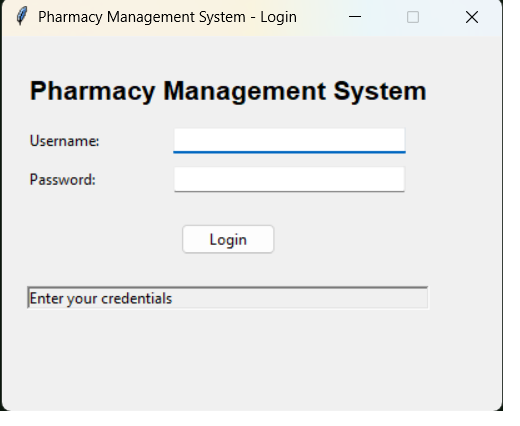
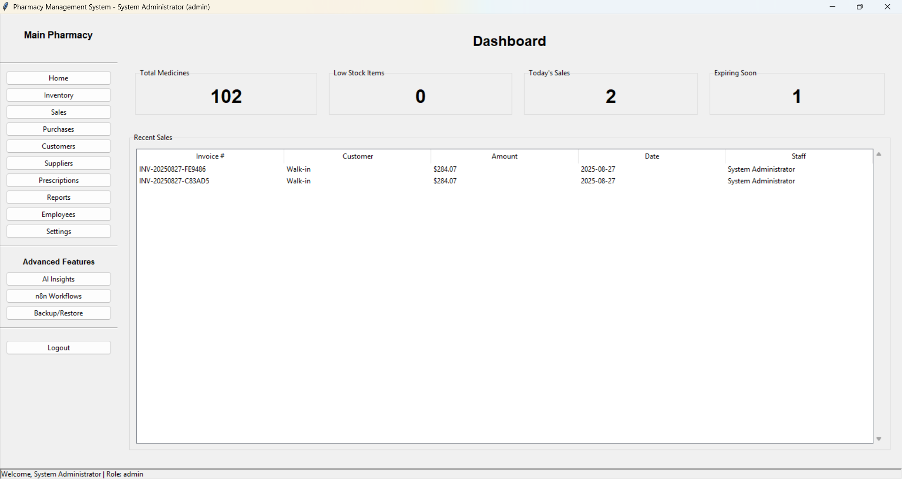
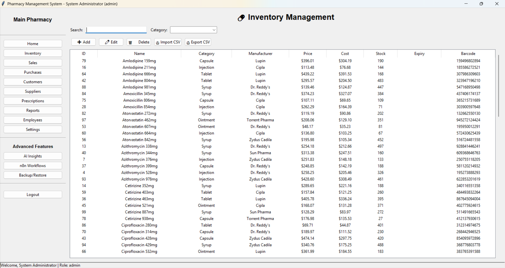

# Pharmacy Management System

A comprehensive pharmacy management solution built with Python, Tkinter, and SQLite. This system helps pharmacies manage their inventory, sales, purchases, customers, suppliers, and more.

## Features

### Core Features

- **Inventory Management**: Track medicines, batches, expiry dates, and stock levels
- **Sales & Billing**: Process sales transactions, generate invoices, manage returns
- **Purchase Management**: Record purchases from suppliers, update inventory automatically
- **Customer Management**: Track customer information, purchase history, and loyalty points
- **Supplier Management**: Manage supplier information and purchase history
- **Employee Management**: Manage employee accounts with role-based access control
- **Prescription Management**: Record customer prescriptions and set up refill reminders
- **Reports Generation**: Generate various reports for business insights
- **Daily Closing**: Record end-of-day totals and generate closing reports

### Advanced Features

- **Multi-Store Support**: Manage multiple pharmacy locations
- **Barcode Scanning**: Support for barcode scanners and webcam-based scanning
- **Drug Interaction Checks**: Check for potential drug interactions
- **GST Compliance**: Generate GST-compliant invoices and reports
- **Loyalty Program**: Track and redeem customer loyalty points
- **Offline-First Architecture**: Works offline and syncs with cloud when online
- **AI Integration**: AI-powered stock prediction and alternative suggestions
- **Text-to-Speech**: Accessibility features for visually impaired users
- **n8n Integration**: Workflow automation with n8n

### Technical Features

- **Role-Based Access Control**: Different permission levels for different user roles
- **Audit Logging**: Track all critical changes in the system
- **Backup & Restore**: Automated backups and easy restoration
- **Import/Export**: Import and export data in CSV format
- **PDF Generation**: Generate PDF reports and invoices
- **SMS/WhatsApp Notifications**: Send notifications to customers and staff

## Installation

1. Clone the repository:
   ```bash
   git clone https://github.com/yourusername/pharmacy-management-system.git
   cd pharmacy-management-system
   ```
   Install the required dependencies:
   bash

pip install -r requirements.txt
Run the application:




Usage
Login
Default admin credentials:
`Username: admin
Password: admin123`
Dashboard

- The dashboard provides an overview of key metrics and quick access to all modules
- Navigation is through the sidebar menu
- Role-based access control limits functionality based on user role

#### Modules

-Inventory: Add, edit, delete, and search medicines
-Sales: Process sales transactions and generate invoices
-Purchases: Record purchases from suppliers
-Customers: Manage customer information
-Suppliers: Manage supplier information
-Employees: Manage employee accounts (admin only)
-Prescriptions: Record and manage prescriptions
-Reports: Generate various reports
**-Advanced Features**
-AI Integration: Predict stock requirements and find alternative medicines
-n8n Integration: Connect to n8n for workflow automation
-Backup/Restore: Backup and restore your database
_Configuration_
-Store Settings
-Navigate to Settings > Store Settings to configure your pharmacy details
-Upload your logo for a personalized experience
-Set your GST number for tax compliance
-AI Settings
-Configure AI features in the AI Integration section
-Train the stock prediction model with your historical data
-n8n Integration
-Set up your n8n URL and API key in the n8n Integration section
-Create workflows in n8n to automate tasks
-Developer Guide
-Project Structure
`
pharmacy_management/
├── main.py # Entry point
├── database.py # SQLite database operations
├── auth.py # Authentication system
├── dashboard.py # Main dashboard
├── inventory.py # Inventory management
├── sales.py # Sales and billing
├── purchases.py # Purchase management
├── customers.py # Customer management
├── suppliers.py # Supplier management
├── employees.py # Employee management
├── prescriptions.py # Prescription management
├── reports.py # Report generation
├── ai_integration.py # AI features
├── n8n_integration.py # n8n workflow integration
├── pdf_generator.py # PDF invoice generation
├── utils.py # Utility functions
├── config.py # Configuration settings
└── requirements.txt # Python dependencies`
_Database Schema_
The system uses SQLite with the following main tables:

-users: User accounts and roles
-stores: Pharmacy store information
-medicines: Medicine inventory
-customers: Customer information
-suppliers: Supplier information
-sales: Sales transactions
-sale_items: Items sold in each transaction
-purchases: Purchase transactions
-purchase_items: Items purchased in each transaction
-prescriptions: Customer prescriptions
-prescription_items: Medicines in each prescription
-audit_log: System audit trail
-Extending the System
-Add new modules by creating new Python files and importing them in the dashboard
-Extend the database schema by modifying database.py
-Add new reports by extending the reports.py module
-Integrate with external APIs by adding new integration modules
-Support
For support, please contact:

`Email: support@pharmacymanagement.com
Phone: +1-555-1234
Documentation: https://docs.pharmacymanagement.com`
License
This project is licensed under the MIT License - see the LICENSE file for details.

Contributing
We welcome contributions! Please see our contributing guidelines for more information.

Changelog
Version 1.0.0
Initial release
Core inventory, sales, and purchase management
User authentication and role-based access
PDF invoice generation
AI integration for stock prediction
n8n workflow integration

This comprehensive Pharmacy Management System includes all the requested features:

- Admin and pharmacist login with role-based access control
- n8n integration for workflow automation
- AI integration for stock prediction and alternative suggestions
- Bulk import/export functionality
- PDF invoice generation
- Whitelabel store support with customizable branding
- Comprehensive documentation for both developers and customers

The system is designed to be modular and extensible, allowing for easy addition of new features and modifications. The code is well-structured with clear separation of concerns between different module
